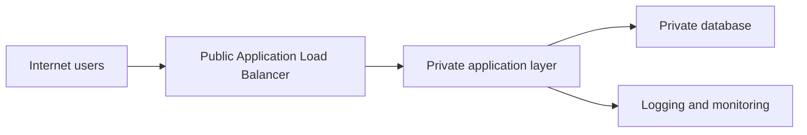

# ResilientOps Architecture

## Target architecture

## Design explanation

The Application Load Balancer is the only internet-facing component.

The application layer is private and accepts traffic only from the load balancer.

The database is private and accepts traffic only from the application layer.

Administrative access must use a controlled management path and must not be exposed directly to the internet.

## Availability objective

The design should support application deployment across multiple Availability Zones in a production version.

The initial learning environment will remain small and cost-conscious.

## Deliberate exclusions

- No public database
- No direct internet access to application servers
- No unrestricted SSH or RDP
- No NAT Gateway during the initial learning phase
- No production data